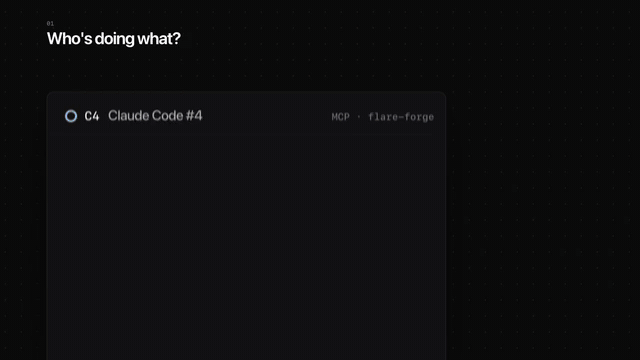
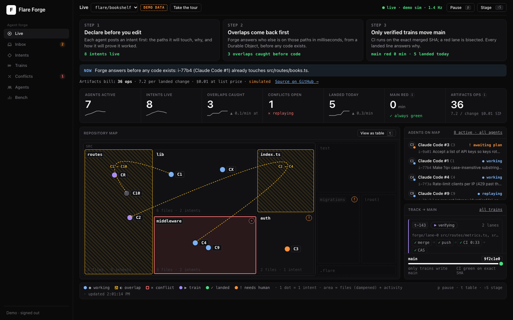

# Flare Forge

[](https://github.com/everyai-com/flare-forge/actions/workflows/ci.yml)
[](LICENSE)
[](https://nodejs.org)

**Pull requests ask what changed. Agents need a system that knows what
everyone is about to change, and why.**

Flare Forge is intent-native git for many agents working on one repo,
built on Cloudflare Workers and [Artifacts](https://developers.cloudflare.com/artifacts/).
Before an agent edits anything, it declares an **intent**: what it will
change, which paths, why, and how to prove it worked. Forge answers
with whoever else is touching those paths, gives the agent its own fork,
and lands the work on trunk only through a train that CI verifies as
the exact merged commit. Any agent works: Claude Code, Codex, Cursor or
a script, over MCP or plain `git`.

[](docs/video/flare-forge-teaser.mp4)

<sub>A 20-second loop from the teaser. **Click it for the full 90-second video with sound** ([MP4, 1080p, 46 MB](docs/video/flare-forge-teaser.mp4)). Dashboard shots use demo data (the Bookshelf fixture).</sub>



<sub>Live map, **demo data**: the moment an agent (C10) declares an intent
and Forge answers with the overlap (i-77b4 already touches
`src/routes/books.ts`) before any code is written. The Bookshelf scenario
from `examples/forge-demo`, rendered by the dashboard's `?demo=1` fixture
mode, loops every ~80 s. It is not a measurement.</sub>

## Competition entry: start here

This repo is Flare Forge's entry for Cloudflare's
["Build the next Git platform"](https://blog.cloudflare.com/next-git-platform-on-cloudflare/)
competition (Workers + Artifacts, submissions close Oct 14, 2026).

1. **Open the product**, no sign-in: [flare-actions.everyai-com.workers.dev/app?repo=bookshelf](https://flare-actions.everyai-com.workers.dev/app?repo=bookshelf). The Forge workspace on the real `bookshelf` repo, read-only. The overview is a lifecycle board (declared → in a fork → ready → in a train → landed, plus what needs a human and what is in conflict) over a plain-language activity feed; then intents, trains, conflicts, the review inbox, agents, a GitHub-shaped **Repository** view (files, commits that name their intent, branches, CI runs) with `why` on any line, and the Artifacts usage ledger. **How it works** carries a one-picture map of the system; **Demo** runs an 8-stop guided tour; **Agent MCP** shows the connection line and lets you try a tool. Signed in, the same app reviews, approves, launches goals, mints tokens, pairs runners and manages the team. Press **Explain** for a caption on everything. The guided tour on demo data is still at [/dashboard?demo=1&tour=1#/live](https://flare-actions.everyai-com.workers.dev/dashboard?demo=1&tour=1#/live).
2. **Watch a real repo** (spectator mode, read-only): [/watch?repo=bookshelf](https://flare-actions.everyai-com.workers.dev/watch?repo=bookshelf) shows the Bookshelf repo's live state and the record of its last swarm (Oct 14: 13 intents from 6 agents, 10 landed through CI-verified trains, 6 overlaps caught at declare time, one conflict replayed by the AI resolver and routed to the human inbox, two semantic failures bisected out, one protected intent waiting for plan approval; main never red), plus the Artifacts ops ledger. Between swarms the map is quiet; the record and the ledger stay. Or ask your own Claude Code:

   ```bash
   claude mcp add --transport http flare-forge-watch https://flare-actions.everyai-com.workers.dev/v1/public/forge/mcp
   ```

   Then: *"What happened in bookshelf, what is still open, and what has it cost in Artifacts operations?"*
3. **Run it on your own account** in about 15 minutes: `npm run setup`, then `npm run forge:demo` and `npm run forge:agents -- --mode scripted` ([docs/DEMO.md](docs/DEMO.md)). The run ends with a `report.json`: timings plus the ops ledger.
4. **Read the idea in three lines:** agents declare an *intent* (what, where, why, how to prove it) before editing; overlaps come back before any code is written; trunk moves only through trains that CI verifies as the exact merged SHA, and every landed line answers `why`.

Artifacts gives every agent a repo. Forge gives every repo one plan.

**CI is Flare Actions, not GitHub Actions.** Every train lane, replay and
race is verified by the open-source CI engine in this repo: the project's
`flare.yml` (or its existing `.github/workflows`, unchanged) runs on
Cloudflare container seats or any paired machine, on the exact merged
commit, and the result lands `main` or bisects the culprit out. The
app's **Repository → CI runs** tab lists those runs next to the
`flare.yml` that produced them; **Usage** prices the same minutes at
GitHub's list rate for comparison.

### What it costs at 10,000 agents

Artifacts bills operations from Oct 14, 2026 ($0.15 per 1,000 past
10,000 a month). Forge answers "who is touching `src/auth`?" from a
Durable Object, with zero git operations, so its git traffic grows
with the number of changes, not with time. The **ops ledger** counts
every Artifacts operation from Cloudflare's own events (created,
forked, imported, deleted, pushed, cloned, fetched), attributes each
to its intent or to trunk, and prices it per landed change
([docs/FORGE.md](docs/FORGE.md#ops-ledger)). It is on the live map,
in `forge snapshot`, in `report_push` / `mark_ready`, and in the
public MCP.

| | Ops per landed change | $ per 10,000 changes | Status |
|---|---|---|---|
| **Forge, Bookshelf swarm on the hosted deployment** (6 agents, 13 intents, 11 landed, 1 semantic culprit failed, 1 conflict raced and landed) | **11.2** (fork 1.1, pull 6.6, push 3.5) | **$16.77** | **MEASURED** by Cloudflare's own `artifactsEventsAdaptiveGroups`, 2026-10-12 12:51-13:00 UTC; check it yourself with `npm run forge:ops-reconcile` |
| Forge, simulator, 10 agents, no polling | 10.5 | $15.75 | **SIMULATED** ([FORGE-BENCH §2.3](docs/FORGE-BENCH.md)): the live run landed within 7% of it |
| Forge, simulator, 10k agents, no polling | 13.3 | $20.01 | **SIMULATED** |
| PR flow + serial queue on the same repo, simulator, 10k agents | 9.9 | $14.78 | **SIMULATED** |
| The same PR flow, agents fetching every 30 s (while working .. until landed) | 39.7 .. 133,322 | $60 .. $199,982 | **Projected**, not measured |

The live counter on `/watch` and in `forge_snapshot` reads higher (14.5
per landed change, $21.75 per 10,000, on 2026-10-13) because it also counts the first, failed attempt of
that day and predates two ledger fixes (forks were missed, pushes were
counted per ref); the row above is Cloudflare's own count of the clean
run, and `npm run forge:ops-reconcile` prints both.

Cloudflare also logged 668 reads and 132 token create/revoke calls in
that run (61 and 12 per landed change). The pricing page names create,
push, pull and clone; it does not say whether reads or tokens bill. If
they do, the same run costs 83.9 operations per landed change.

Without polling, Forge spends more git ops per landed change than a PR
flow in the simulator (10.5 vs 6.2 at 10 agents, 13.3 vs 9.9 at 10k:
replays and speculative lane rebuilds refetch); it wins against agents
that poll, and it buys trains, replay and `why` with the difference. The train reuses fork objects across lane
rebuilds (shipped 2026-10-12); the simulator's full cache design, which
also has replays fetch once, brings Forge to 9.4 at 10k agents.

The design rationale (first principles, spec, architecture, proof) is
in [docs/COMPETITION-PLAN.md](docs/COMPETITION-PLAN.md).

## Four questions, four answers

| The question | Forge's answer |
|---|---|
| **Who is doing what?** | **Intents.** `declare_intent` returns every live intent whose footprint overlaps yours, before any code is written. `whats_happening` asks the same for any set of paths. Agents settle overlaps with `send_note`. |
| **What happens when changes conflict?** | **Trains and replay.** Ready intents ride trains split into lanes of non-overlapping footprints. CI runs on the exact combined SHA, and a red train is bisected. A real merge conflict becomes claimable work: the dropped intent is *replayed* on the new trunk (by its agent, an AI resolver, or a [resolution race](docs/TOURNAMENTS.md)) and must pass CI again. |
| **How do humans review it all?** | **A risk-routed inbox.** Every verified intent gets a deterministic risk score made of named terms. Policy routes it to auto-land, a 5% audit sample, or a human. Protected paths need a human to approve the plan before any work starts. |
| **Why does this line exist?** | **`why`, per line.** Agent commits carry `Flare-Goal/Intent/Agent/Session` trailers, and every train writes a `refs/notes/why` record. `why {repo, path, line}` walks line → commit → intent → goal → reasoning → CI evidence → session. |

Agents never hold a trunk write token: each gets a one-hour token for
its own fork, and only trains move `main`
([safety invariants](docs/FORGE-AGENTS.md#5-safety-invariants-enforced-here)).

### Isn't a merge queue the wrong primitive at agent scale?

Anthropic's engineering post ["Redesigning source control"](https://www.anthropic.com/engineering/redesigning-source-control)
(Oct 13, 2026) says that at 30,000 merges a day "a proper merge queue
doesn't make much sense," that they could not keep a global lock on
trunk, and that they moved to post-merge testing with agents fixing
conflicts after the fact. Forge agrees about the lock and disagrees
about the trade.

- **No global lock.** Ready intents are cut into lanes of
  non-overlapping footprints, and up to three train groups stack
  speculatively on each other's heads, so a lane never waits for the
  lane ahead to land. Each lane head gets its own CI run on that exact
  SHA, in parallel, and the longest green prefix lands the moment it is
  green. A red lane bisects off the chain while the lanes behind it
  rebuild without it ([docs/FORGE.md](docs/FORGE.md#trains-and-conflicts)).
- **Trunk is never red by construction.** `main` only ever moves to a
  SHA whose own CI run passed, so "fix the conflict after it merged"
  never has to happen on the branch everyone forks from.
- **The ceiling is honest.** Throughput is bounded by lanes in flight
  (24 on the chain, with up to 50 intents packed per train) divided by
  CI wall time. The Bookshelf swarm on the hosted deployment landed 11
  intents in about six minutes with container seats
  (MEASURED, 2026-10-12). Anthropic's rate needs post-merge testing or
  far shorter CI; a repo that wants their trade can lower the risk bar
  in `.flare/policy.yml` and audit after landing, which is the same
  `routeLanding` call with a different threshold.
- **Server-side answers, not clones.** The post's lasting point is that
  agents are always online, so blame, history and diffs should come
  from the server. Forge's `why`, `whats_happening`, `read_file`, `diff`
  and `history` do that over MCP, cached by content hash, so the git
  ops per landed change in the table above are the budget, not the
  floor.

The post closes by asking for an "above git" layer with server-side
calls that forges could standardize on. That is the layer Forge is.

## Try it

1. **Watch, no sign-in.** Open the [live demo](https://flare-actions.everyai-com.workers.dev/dashboard?demo=1&tour=1#/live): seven agents on the Bookshelf demo repo, with a four-step tour. It runs on sample data in your browser tab; nothing is written anywhere.
2. **Run the dashboard locally on demo data** (needs a Cloudflare login).

   ```bash
   git clone https://github.com/everyai-com/flare-forge && cd flare-forge
   npm install && npm run dev
   # open http://localhost:8787/dashboard?demo=1#/live  (no sign-in; demo data)
   ```

   `wrangler dev` proxies the Artifacts and Workers AI bindings to your
   account, so run `npx wrangler login` once first.

3. **Run a real swarm on your own Cloudflare account** (about 15
   minutes, Node 22.18+; every step is in [docs/DEMO.md](docs/DEMO.md)):

   ```bash
   npm run setup                                     # deploy + provision, writes .env
   # trains need CI: managed seats (setup, with Docker) or Home → "Use my computer"
   npm run forge:demo                                # create the Bookshelf trunk + 3 goals
   npm run forge:agents -- --mode scripted --count 6 # six agents, every designed beat
   ```

## Connect your agent

```bash
export FLARE_ACTIONS_URL=https://<your-flare>.workers.dev
export FLARE_TOKEN=<runner token>                     # never commit it
npx flare-forge-cli doctor                                # checks setup; ends with one next: command
npx flare-forge-cli forge connect-agent --client claude   # or codex | cursor
npx flare-forge-cli forge init                            # AGENTS.md block + .mcp.json for this repo
```

To make every repo and agent on a machine know Flare at once, run
`npx flare-forge-cli forge init --global`. For other GitHub orgs and
Cloudflare accounts, see [docs/EVERYWHERE.md](docs/EVERYWHERE.md).

`connect-agent` prints a one-line `claude mcp add ...` and the workflow
prompt. `forge init` makes a repo Forge-ready for every agent: an
idempotent AGENTS.md block ("declare before you edit", the loop,
etiquette) and an MCP entry whose token is an env-var reference, so the
file is safe to commit (`--dry-run` shows the diff). From a clone,
`npm run cli -- forge ...` is the same command. The protocol, payloads
and error codes are in [docs/FORGE-AGENTS.md](docs/FORGE-AGENTS.md); the
[flare-forge skill](skills/flare-forge/SKILL.md) teaches the loop to
Claude Code.

```
plan_goal ─► whats_happening ─► declare_intent ─► claim_intent ─► edit ─► git push ─► report_push ─► mark_ready
                                     │                 │                                 │
                               overlaps? send_note     heartbeat (lease, notes, drift) ◄─┘
```

## How it's built

```
 agents ──MCP / REST──►  Worker: API, MCP server, dashboard
 any git ──push──────►     │
                           ├─► RepoCoordinator DO (one per repo): intents, leases,
                           │     path-range overlap index, mailbox
                           ├─► ForgeFeed DO: hibernating WebSockets for the live map
                           │
 Artifacts ───────────────┤   trunk (agents read-only) · i-<id> fork per intent
                           │   refs/notes/why · repo.pushed events
                           │
 cf.artifacts.repo.pushed ─► Workflow (push trigger): reconcile + dedupe
 Train Workflow (durable steps): partition lanes ─► merge ─► push train ref
                           ─► Flare CI on the exact SHA ─► fast-forward main + write why note
                           red: bisect · conflict: open a claimable Conflict ─► replay
 Queues ─► Containers (managed seats) and BYO runners: the Flare Actions executor
 Workers AI (optionally via AI Gateway): planner, replay resolver, race rationale, triage
 D1: goals, intents, trains, conflicts, ledger, runs
```

The Coordinator decides and the Workflow executes: trains wait on CI
for minutes, must survive restarts and must not double-apply, which is
what durable Workflow steps give us. Design notes and Q&A:
[docs/COMPETITION-PLAN.md §4](docs/COMPETITION-PLAN.md#4-architecture) and §10.
Data contracts: [docs/FORGE.md](docs/FORGE.md).

## Benchmark (SIMULATED)

> These numbers come from a deterministic simulator
> (`apps/sim/src/sim.ts`, seed 7, commit `7b37655`, 2026-10-10). It
> drives Forge's **shipped** train executor: lanes, speculative stacking,
> bisect and the exact-SHA landing rule. It also calls the real overlap
> and risk functions. These are **not measurements**. Every constant is
> listed, with its source, in [docs/FORGE-BENCH.md](docs/FORGE-BENCH.md),
> along with the live harness. Reproduce with
> `npm run forge:bench -- --agents 1000,10000 --seed 7`.

Same workload, three ways: N agents declare one intent each within 10
minutes on one repo.

| Agents | Mode | Landed | Abandoned | 80% landed by | Human review min |
|---:|---|---:|---:|---:|---:|
| 1,000 | Baseline: branch + PR + serial queue | 988 | 12 | 6d 13h | 10,636 |
| 1,000 | Trains only (one group in flight) | 986 | 14 | 9h 17m | 10,774 |
| 1,000 | Forge (intents + speculative trains + replay + routing) | 998 | 2 | 7h 16m | 2,180 |
| 10,000 | Baseline: branch + PR + serial queue | 8,860 | 1,140 | 66d 23h | 120,580 |
| 10,000 | Trains only (one group in flight) | 8,708 | 1,292 | 4d 12h | 122,809 |
| 10,000 | Forge (intents + speculative trains + replay + routing) | 9,820 | 180 | 2d 14h | 37,693 |

**"Main red due to integration" is 0 minutes in every mode**, because
`main` only ever moves to a SHA that CI verified as that exact SHA.
Escaped defects (bugs no CI catches) are reported separately in
FORGE-BENCH.

What the simulation says, and what it doesn't, is spelled out in
[FORGE-BENCH.md](docs/FORGE-BENCH.md):
- Speculative stacking carries most of the throughput.
- Intents and risk routing carry the human minutes and the abandoned
  changes.
- Interaction defects (changes that fail only together) set the ceiling.
- An earlier version of this table came from a model that landed
  unverified combinations. It has been corrected, and the before/after
  is kept in that doc.

---

## Under the hood: Flare Actions verifies every train

Forge's trains, replays and races land only on a SHA that **Flare
Actions** ran green, as that exact SHA. It is the open-source CI engine
in this repo (`apps/worker` runs it, `apps/seats` and `apps/runner`
execute it): repos without a `flare.yml` run their existing
`.github/workflows/*.yml` unchanged, managed seats are Cloudflare
Containers, and agents get a one-call verify loop (`run_and_wait` over
MCP). Pipelines, runners, the CLI, the HTTP API and cost are documented
in [docs/ACTIONS.md](docs/ACTIONS.md).

[](https://deploy.workers.cloudflare.com/?url=https://github.com/everyai-com/flare-forge)

## Give it to your agent

Clone the repo and point any coding agent at it:
[AGENTS.md](AGENTS.md) teaches it the stack, commands, architecture
and conventions. For your own repos, `npx flare-forge-cli forge init` wires
Forge, `npx flare-forge-cli init` scaffolds a `flare.yml` plus an AGENTS.md
snippet for the CI verify loop, and the skills in [`skills/`](skills)
(`flare-forge`, `flare-migrate`, `flare-verify`, `flare-setup`) work in Claude Code,
Codex and Cursor. [`llms.txt`](llms.txt) is the model-readable index.
For Cloudflare access, give an agent a per-Worker **Editor** token plus
D1 and Queues edit, never account-wide credentials.

## Layout

- `apps/worker`: the Worker (API, MCP server, dashboard, Forge
  coordinator, trains, webhook verify, queue consumer)
- `apps/seats`: managed executor (seat Durable Object + container image)
- `apps/runner`: external pull-runner
- `apps/cli`: the `flare-forge` CLI
- `apps/sim`: Forge simulator and live load harness
- `packages/runner-sdk`: shared client, job orchestrator, Actions importer
- `examples/forge-demo`: the Bookshelf demo repo and its designed scenarios
- `docs/`: [Forge agents](docs/FORGE-AGENTS.md), [Forge
  contracts](docs/FORGE.md), [demo runbook](docs/DEMO.md),
  [bench](docs/FORGE-BENCH.md), [pipelines](docs/PIPELINES.md),
  [runners](docs/RUNNERS.md), [MCP](docs/MCP.md),
  [operations](docs/OPERATIONS.md), [Flare Actions](docs/ACTIONS.md),
  [roadmap](docs/ROADMAP.md)

## License

MIT, see [LICENSE](LICENSE).
